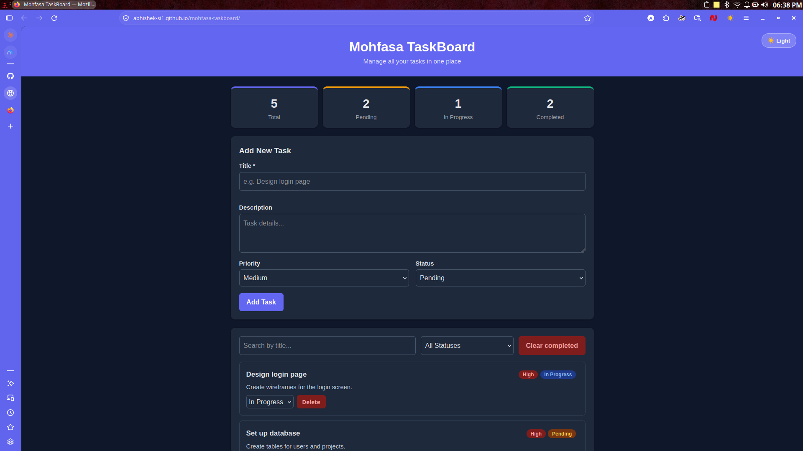
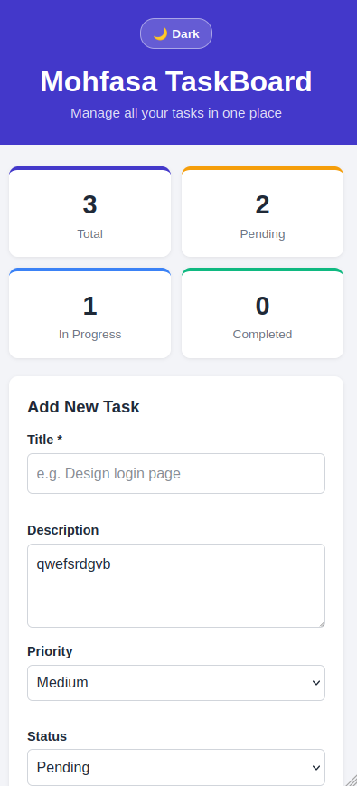
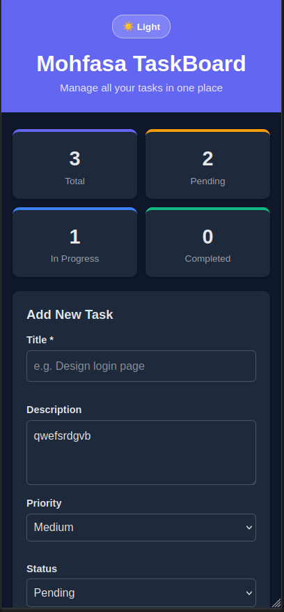

# Mohfasa TaskBoard

A responsive task management dashboard built for **Mohfasa Project Lab – Selection Assignment 01**. Users can view, create, search, filter, update and delete tasks in one place, on both mobile and desktop.

**Live demo:** https://abhishek-si1.github.io/mohfasa-taskboard/

**Repository:** https://github.com/Abhishek-si1/mohfasa-taskboard

## Screenshots

| Desktop (dark) | Mobile (light) | Mobile (dark) |
|---|---|---|
|  |  |  |

## Features

**Dashboard**
- App name and live counts for Total, Pending, In Progress and Completed tasks
- Five sample tasks loaded on first visit
- Counts update automatically whenever tasks change

**Task management**
- Add a task with title, description, priority and status
- Title is required: the form will not submit an empty title and shows an inline error
- Change a task's **status** (Pending / In Progress / Completed) from a dropdown
- Change a task's **priority** (Low / Medium / High) from a dropdown
- Delete a task after a confirmation prompt
- "Clear completed" button to remove all finished tasks (with confirmation)

**Search and filter**
- Search tasks by title (case-insensitive, updates as you type)
- Filter by status

**UI / UX**
- Clean, responsive layout using CSS Grid and Flexbox (stats collapse to 2 columns and the form stacks on small screens)
- Light and dark theme toggle; the choice is remembered, and the first visit follows the system preference
- Empty state message when no tasks match
- Toast messages for feedback (task added, deleted, updated, etc.)
- Tasks are saved in the browser using `localStorage`, so they persist after a refresh

## Tech stack

- HTML5 (semantic elements: `header`, `main`, `section`, `form`, `label`)
- CSS3 (Grid, Flexbox, CSS variables for theming)
- Vanilla JavaScript (no frameworks, no libraries, no paid services or APIs)
- Git and GitHub, deployed on GitHub Pages

## Project structure

```
mohfasa-taskboard/
├── index.html   # Page structure
├── style.css    # Styling, responsive layout and light/dark theme variables
├── script.js    # Task logic: add, delete, update, search, filter, storage
├── theme.js     # Applies the saved theme before first paint (no flash)
└── README.md
```

## Setup and run locally

No installation or build step is needed.

```bash
git clone https://github.com/Abhishek-si1/mohfasa-taskboard.git
cd mohfasa-taskboard
```

Then open `index.html` in any modern browser. (Optionally use the VS Code "Live Server" extension.)

## How it works

- `tasks` is a single array that holds all task objects: `{ id, title, description, priority, status }`.
- Every change (add, delete, status or priority update, clear completed) goes through one `commit()` function that saves to `localStorage`, re-renders the list, updates the counts and shows a toast.
- Search and filter run in `getVisibleTasks()` and only affect what is displayed, never the stored data.
- One event listener on the task list handles all delete buttons and dropdowns (event delegation).
- User text is passed through `escapeHTML()` before rendering, so task titles cannot inject HTML.

## Biggest challenge and how I solved it

Keeping the UI consistent after every change was the hardest part: adding, deleting, updating a status or priority, searching and filtering all had to refresh the list, the dashboard counts and the saved data without getting out of sync. At first each function repeated the same save, render and message steps. I solved it by keeping one `tasks` array as the single source of truth and routing every change through a single `commit()` function, so the counts, list and storage always match. A second challenge was the dark theme flashing white on page load; I fixed it by applying the saved theme in a tiny `theme.js` loaded in the `<head>` before the page paints.

## Known limitations

- Tasks are stored only in the current browser (`localStorage`); there is no backend or user accounts.
- No edit option for a task's title or description yet.

## Possible future improvements

- Edit title and description
- Due dates and sorting by priority
- Drag-and-drop between status columns
- Backend and database for syncing across devices

## Author

**Abhishek Singh**, [@Abhishek-si1](https://github.com/Abhishek-si1)
